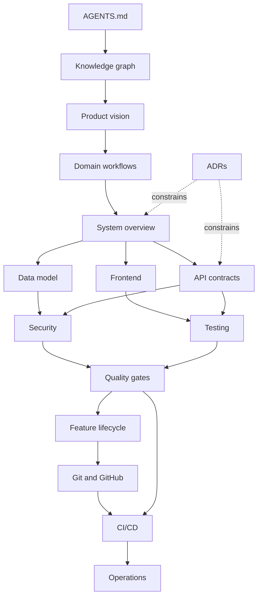

# Rademan Knowledge Graph

Read upstream nodes before changing a downstream concern. Update every affected node when a contract changes.

## Nodes
- [AGENTS](../AGENTS.md): agent contract.
- [Vision](product/vision-and-scope.md): user value and boundaries.
- [Domain](product/domain-workflows.md): actor workflows and invariants.
- [System](architecture/system-overview.md): runtime and stack.
- [Data](architecture/data-model.md): entities and persistence invariants.
- [Frontend](architecture/frontend-and-ui.md): routes, state and UI rules.
- [API](architecture/api-contracts.md): endpoint groups and contracts.
- [Security](security/security-model.md): trust boundaries and threats.
- [Testing](engineering/testing-strategy.md): test layers and commands.
- [Quality](engineering/quality-gates.md): merge blockers and DoD.
- [Lifecycle](delivery/feature-lifecycle.md): stages from issue to release.
- [GitHub](engineering/git-and-github.md): branching, commits, collaboration.
- [CI/CD](operations/ci-cd-and-release.md): workflow/release.
- [Operations](operations/deployment-and-recovery.md): deployment and recovery.
- [ADRs](decisions/index.md): durable decisions.

## Change propagation
Schema/domain → data, domain, API, tests, security. API → API docs, backend tests, frontend consumers, browser E2E. UI/navigation → frontend docs and browser tests. Auth/moderation/messaging/uploads/privacy → threat review. Workflow/release → CI/CD and GitHub docs.
