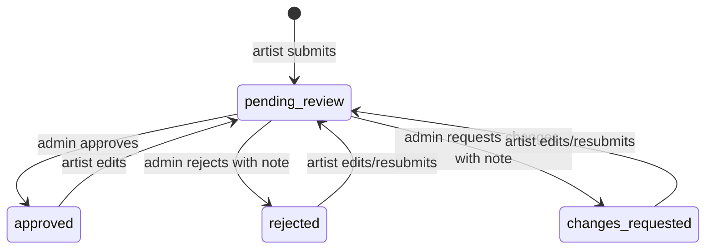

# Domain Workflows and Invariants

## Artist profile
Public registration creates artist by default or buyer by selection; public admin registration is forbidden. An artist owns one profile with unique slug and public/private visibility. Private profile preview is owner/admin only. Incomplete profiles are valid onboarding states.

## Artwork moderation

Only approved works of public profiles appear publicly. Rejection/change request requires a note. Artist edits reset moderation metadata and return to pending review.

## Buyer contact
Buyer inquiry targets an artist and may reference artwork. Artist can inspect, mark read and archive; buyer sees own history. Submission is rate-limited and includes honeypot protection. Direct conversation may start without inquiry and can carry artwork context.

## Conversations and messaging
One canonical conversation per buyer/artist pair, keyed by pair key. Inquiry/artwork are contexts, not duplicate conversations. Only participants may read/write; blocks prevent contact/message actions. Messages support pagination, replies, edit/delete, read/delivery timestamps, reactions and attachments. Reports create moderation work. In-app notifications exist; email is unavailable.

## Editorial
Admins curate ordered collections and artwork membership, plus featured artists with publication windows. Public visibility depends on publication status/time and eligible public content.

## Change checklist
Update domain rule → schema/model → controller/policy → API contract → React consumer → feature test → browser path → security note → roadmap.
